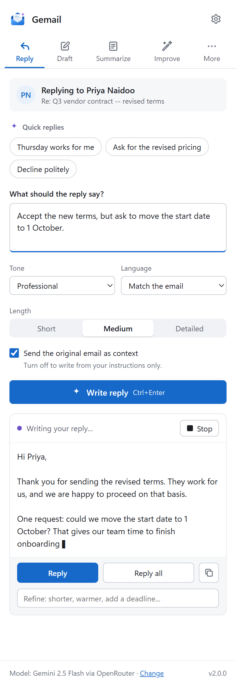
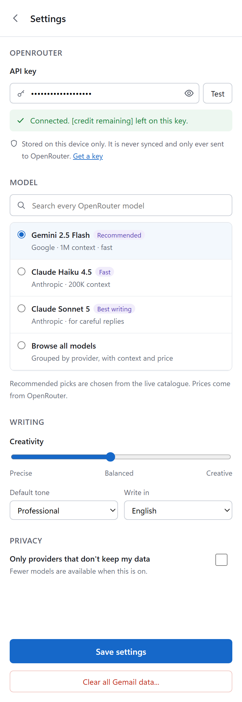

# Gemail Design Mockup

The approved visual design for the Gemail task pane, the ribbon, and every icon. It is the **visual source of truth**: a surface section in `todo/` builds to the artboard it cites here, and review compares the rendered surface against the render below. Values (colors, fonts, spacing) come from [`tokens.json`](./tokens.json); icons come from [`assets/icons/src/`](../../assets/icons/src/) through the registry `src/ui/icons.ts` (catalog: [`icons.md`](./icons.md)); rules that are not visual live in [`taskpane.md`](./taskpane.md).

Order of authority when they disagree: `tokens.json` for a value, this file and its renders for layout and composition, `taskpane.md` for behavior and rules. A disagreement is fixed in the losing file in the same commit, never left standing.

## Source

- Artifact: https://claude.ai/artifact/GHuFwncPVxchLZaPLQvURu (operator-approved on 2026-09-27; private to the operator's account)
- Imported: 2026-09-27, artifact version `1790526473-c417`, into [`mockup/`](./mockup/): `canvas.json` and the four artboards `Main.dc.html`, `Settings.dc.html`, `Improve.dc.html`, `Icons.dc.html`
- Pinned: [`mockup/source.json`](./mockup/source.json) records the version and the sha256 of every imported file; `python scripts/design-lint.py` refuses a hand-edited artboard. Change the design in the artifact and re-import with the `design-sync` skill.
- Renders: [`mockup/renders/`](./mockup/renders/), made by `node tools/design/render-mockup.mjs` (2x PNG per artboard and per state), with the board hash each was made from in `renders/manifest.json`

## How this binds the plan

- Every `todo/` section that builds or changes a surface carries a `**Design:**` line citing at least one anchor of this file (`docs/design/mockup.md#<anchor>`). `python scripts/design-lint.py` makes a missing citation FATAL, in the commit hook and in CI.
- The citation names the artboard or component the section must reproduce 1:1 (layout, spacing, order, copy style, icon, state). A deviation is a `**Design deviation:**` line with a follow-up section, never a silent change.
- A surface this file does not draw cites [Surfaces the mockup does not draw](#surfaces-the-mockup-does-not-draw) plus the nearest pattern anchors, and its section adds the artboard to the artifact through `design-sync` before building when the operator asks for a visual review.
- The code side is held by the same gate: no color literal, font declaration, or inline `<svg>` in `src/` outside the generated token and icon files, on a shrink-only baseline (`docs/design/.lint-baseline.json`).

## Reply read mode

The default view when a message is open in read mode, shown mid-stream (`renders/Main.png`) and finished (`renders/Main--streaming-false.png`). Artboard: `mockup/Main.dc.html`, 400 x 1160.

### Header

The app mark (`assets/icons/src/app/gemail.svg` at 28 px), the product name **Gemail** in `font.size.title` semibold, and one icon button on the right: **Settings** (`settings`, `aria-label="Settings"`, 36 px target). Nothing else: no model name, no provider name.

### Tab bar

Five equal tabs with a 20 px icon over a 12 px label: **Reply** (`reply`), **Draft** (`draft`), **Summarize** (`summarize`), **Improve** (`improve`), **More** (`more`). At rest the icon is the regular glyph in `textSecondary`; the active tab uses the `-filled` glyph, `brand` color, semibold label, and a 2 px `brand` underline. **More** opens the remaining features (Actions, Translate, and later features). Settings and Rules are not tabs: Settings is the header button, Rules sits inside Settings.

### Reply context

A `surface` card: a 32 px initials avatar in `brandTint` / `brand`, **Replying to <sender>** semibold, and the subject on one line in `textSecondary`, truncated with an ellipsis.

### Quick replies

The label **Quick replies** with the filled spark (`spark-filled`, 16 px, `ai`), then pill buttons (`radius.pill`, `borderChip`) that each start a reply from that intent.

### Reply form

The instruction text area with a visible label (**What should the reply say?**) and a 2 px `brand` bottom border; **Tone** and **Language** selects side by side; **Length** as a three-way segmented control (Short, Medium, Detailed) on `surfaceSunken`; the **Send the original email as context** checkbox with its one-line explanation in `textTertiary`.

### Write action

One full-width primary button, 40 px, `brand` fill, `onBrand` text, the filled spark, the verb (**Write reply**), and the shortcut hint (`Ctrl+Enter`) at reduced weight.

### Result card

A bordered card (`border`, `radius.lg`): a status row, the editable result text (`font.lineHeight.reading`), then on `surface` the actions in this order: the insert action for the mode (**Reply**, primary), **Reply all**, **Copy** (icon button `copy`, labelled), and the refine input below. Finished state: the status row shows word count and reading time in `textTertiary` and a **Regenerate** button (`regenerate`).

### Streaming and Stop

While streaming, the status row shows an `ai` dot, **Writing your reply...** as a `role="status"` live region, and a **Stop** button with a filled square; the text grows in place with a caret. Stop keeps the partial text. No full-pane overlay.

### Footer

`textTertiary`, 12 px: **Model: <model name> via OpenRouter** with a **Change** link to Settings, and the version on the right.

## Settings

Artboard: `mockup/Settings.dc.html`, 400 x 1160. A back button (`back`) and the title **Settings**; sections with uppercase `sectionLabel` headings.

### API key

**OPENROUTER**: the key field with the `api-key` glyph, masked, a show toggle (`eye`, labelled **Show key**), and **Test** beside it. The connection result as a `role="status"` row in `successTint` / `success` with `check` (or `dangerTint` / `danger` with `error` on failure). Under it, with the `privacy` shield: **Stored on this device only. It is never synced and only ever sent to OpenRouter.** and a **Get a key** link.

### Model picker

**MODEL**: a search field (`search`) over the whole OpenRouter catalogue, then a radio list of recommended models, each row with the model name, a tag chip in `aiTint` / `aiStrong` (Recommended, Fast, Best writing), and a meta line (provider, context, speed) in `textTertiary`; the selected row sits on `brandSelected`. The last row opens the full catalogue grouped by provider with context and price. A note that recommended picks come from the live catalogue.

### Writing

**WRITING**: the **Creativity** slider with Precise, Balanced, and Creative stops; **Default tone** and **Write in** selects side by side.

### Privacy switch

**PRIVACY**: **Only providers that don't keep my data** as a switch with its consequence (**Fewer models are available when this is on.**) in `textTertiary`. Off by default (operator decision 2026-09-27).

### Save and clear

**Save settings** as the primary button; **Clear all Gemail data...** below it as an outlined `danger` button that opens a confirmation dialog before anything is removed.

## Improve compose dark

Artboard: `mockup/Improve.dc.html`, 400 x 1160, the dark theme (`color.dark`), with the undo confirmation shown (`renders/Improve.png`) and hidden (`renders/Improve--accepted-false.png`).

### Selection context

A `surface` row with `selection`: **Improving your selection** and the size of the selection (sentences) on the right; with no selection it reads **Improving your whole draft**.

### Focus cards

**Focus** as a legend over four toggle cards in a 2 x 2 grid, each with its outline glyph: **Grammar** (`focus-grammar`), **Clarity** (`focus-clarity`), **Concise** (`focus-concise`), **Professional** (`focus-professional`). The pressed card uses `brandTint` fill, `brand` border, and `brand` icon; `aria-pressed` carries the state.

### Diff view

A bordered card: the change count and a legend (Removed, Added), then the text with removed words struck through on `diffRemovedBg` / `diffRemovedText` and added words on `diffAddedBg` / `diffAddedText`; then **Replace selection** (primary), **Copy**, and a labelled **Try again** icon button (`regenerate`).

### Undo confirmation

After a replace, a `role="status"` row with `check` in `success`: **Selection replaced. The rest of your email is unchanged.** and an **Undo** action (`undo`) that restores the original selection.

### Error banner

A `role="alert"` banner on `dangerTint` with `error`: what happened (**OpenRouter is rate limiting this key. Gemail tried 3 times.**), what to do in `textSecondary`, and a **Retry** button when retrying can help. Every error message follows this two-line shape.

### Dark theme

Every surface uses the `color.dark` token set when Outlook is dark; the app mark's spark keeps a cut-out against the dark background. The light artboards and this one are the same components with the two token sets.

## Icons

Artboard: `mockup/Icons.dc.html`. The icon sources extracted from it are canonical in `assets/icons/src/`; [`icons.md`](./icons.md) is the catalog.

### App icon

An open envelope with a letter and the spark, shape-based with no tile. Drawn once at 48 (used for 32, 64, 80, 128, 256) and redrawn at 16 (`gemail-16.svg`). Rendered PNGs: `assets/icons/png/app/`.

### Ribbon

Compose mode: one group **Gemail** with **Open Gemail** (the app icon) and the **AI Tools** menu button (`ribbon/ai-tools.svg`). Read mode: **Open Gemail** only. Fluent color style.

### AI Tools menu

**Fix grammar & spelling**, **Improve clarity**, **Make concise**, **Make professional**, a separator, then **My prompts...** (`menu/*.svg`, Fluent color style, rendered at 16, 32, and 80 px under `assets/icons/png/menu/`).

### Pane icons

Fluent 2 system style on a 20 px grid, 1.4 px stroke, regular at rest and filled when active; purple (`aiIcon`) only on the spark. Every glyph is in `assets/icons/src/pane/` and reaches code only through `iconSvg()` in `src/ui/icons.ts`.

## Surfaces the mockup does not draw

Draft, Summarize, Extract actions, Translate, Rules, templates, the first-run privacy notice, the offline banner, custom prompts, attachments, the thread timeline, CC suggestions, usage stats, and the user guide have no artboard yet. A section building one of them composes it only from the components above (header, tab bar, form controls from [Reply form](#reply-form), [Write action](#write-action), [Result card](#result-card), [Error banner](#error-banner), [Settings](#settings) rows) and the icons in [Pane icons](#pane-icons), cites this heading plus those component anchors on its `**Design:**` line, and adds its artboard to the artifact (the `design-sync` skill) before building when the operator asks for a visual review first.
