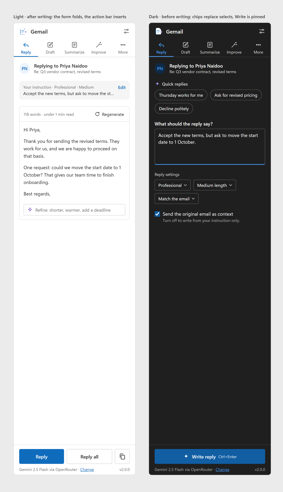
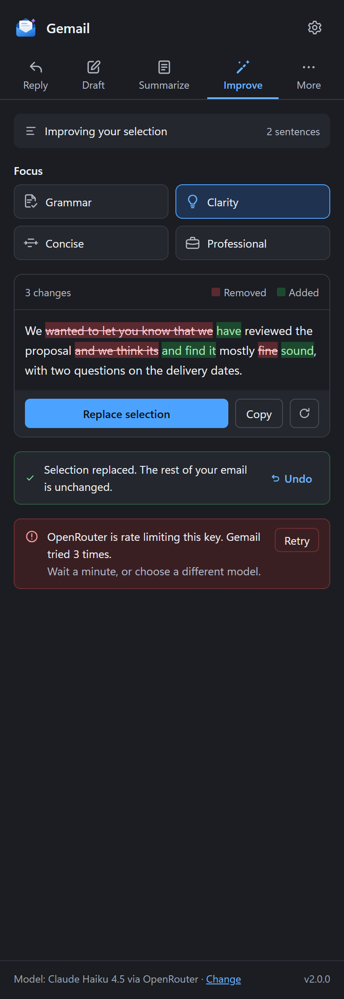
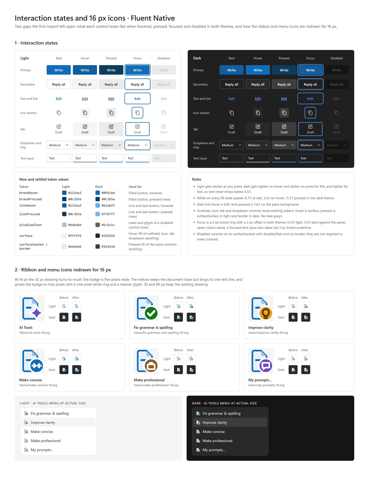
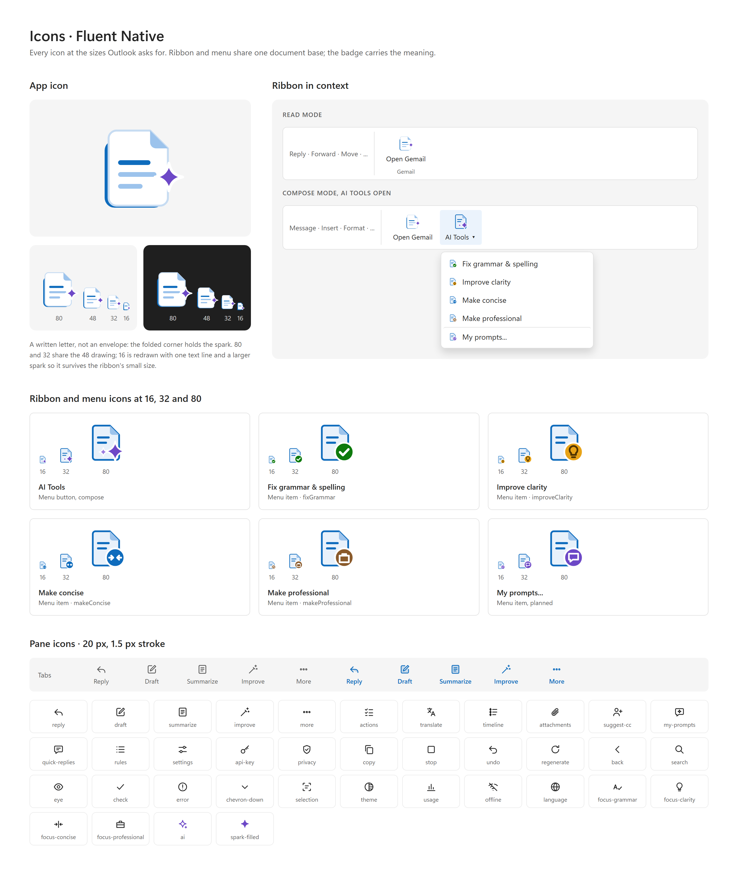

# Gemail Design Mockup

The approved visual design for the Gemail task pane, the ribbon, and every icon: **Fluent Native** (operator decision 2026-11-15: "Most definately A"), which replaced the 2026-09-27 mockup. It is the **visual source of truth**: a surface section in `todo/` builds to the artboard it cites here, and review compares the rendered surface against the render below. Values (colors, fonts, spacing) come from [`tokens.json`](./tokens.json); icons come from [`assets/icons/src/`](../../assets/icons/src/) through the registry `src/ui/icons.ts` (catalog: [`icons.md`](./icons.md)); rules that are not visual live in [`taskpane.md`](./taskpane.md).

Order of authority when they disagree: `tokens.json` for a value, this file and its renders for layout and composition, `taskpane.md` for behavior and rules. A disagreement is fixed in the losing file in the same commit, never left standing.

## Source

- Artifact: https://claude.ai/artifact/Vc5xq9U5iRvq1AiZ1gm5YD (operator-approved on 2026-11-15; private to the operator's account). It replaces https://claude.ai/artifact/GHuFwncPVxchLZaPLQvURu, the 2026-09-27 design, which is retired and no longer imported.
- Imported: 2026-11-15, artifact version `1794766595-aa03`, into [`mockup/`](./mockup/): `canvas.json` and the six artboards `Main.dc.html` (overview and tokens), `Icons.dc.html`, `Reply.dc.html`, `Improve.dc.html`, `Settings.dc.html`, and `States.dc.html` (interaction states and the 16 px icon redraws, approved the same day)
- Pinned: [`mockup/source.json`](./mockup/source.json) records the version and the sha256 of every imported file; `python scripts/design-lint.py` refuses a hand-edited artboard. Change the design in the artifact and re-import with the `design-sync` skill.
- Renders: [`mockup/renders/`](./mockup/renders/), made by `node tools/design/render-mockup.mjs` (2x PNG per artboard), with the board hash each was made from in `renders/manifest.json`. Each pane artboard draws the pane twice, light on the left and dark on the right, at 360 px wide.

## How this binds the plan

- Every `todo/` section that builds or changes a surface carries a `**Design:**` line citing at least one anchor of this file (`docs/design/mockup.md#<anchor>`). `python scripts/design-lint.py` makes a missing citation FATAL, in the commit hook and in CI.
- The citation names the artboard or component the section must reproduce 1:1 (layout, spacing, order, copy style, icon, state). A deviation is a `**Design deviation:**` line with a follow-up section, never a silent change.
- A surface this file does not draw cites [Surfaces the mockup does not draw](#surfaces-the-mockup-does-not-draw) plus the nearest pattern anchors, and its section adds the artboard to the artifact through `design-sync` before building when the operator asks for a visual review.
- The code side is held by the same gate: no color literal, font declaration, or inline `<svg>` in `src/` outside the generated token and icon files, on a shrink-only baseline (`docs/design/.lint-baseline.json`).

## Design language

Artboard: `mockup/Main.dc.html`. Gemail lives inside Outlook's chrome, so it looks like it belongs there: Fluent 2 metrics, the communication blue, Outlook's neutral greys, and Segoe UI Variable on Fluent's type ramp. The rules every surface follows:

- **Color.** `brand` is the text, link, and indicator shade; `brandFill` is the filled-button shade with `onBrand` text (the dark theme splits the two so both pass 4.5:1). Purple (`ai`, `aiTint`, `aiIcon`) is reserved for AI: the spark and the model tags, nothing else.
- **Type.** Title 20/28 semibold, subtitle 16/22 semibold, body 14/20, reading 14/22 for results, caption 12/16 (`font.size`, `font.lineHeight`).
- **Radius.** Inputs and buttons `radius.sm` (4), cards `radius.md` (8), dialogs `radius.lg` (12), chips `radius.pill`.
- **Spacing.** A 4 px grid. Pane gutter 16 (`space.paneGutter`), section gap 20 (`space.sectionGap`), control height 32 (`size.input`), touch targets 36 at least and 44 in the action bar (`size.actionBarButton`).
- **Pane frame.** Three fixed bands: the header and tab bar at the top, the scrolling content in the middle, and the [Action bar](#action-bar) pinned at the bottom. The primary action is always in the action bar, never in the scrolling content.

## Reply read mode

The default view when a message is open in read mode. Artboard: `mockup/Reply.dc.html`, two panes of 360 x 1340: the result state after writing (left, light) and the form before writing (right, dark).

### Header

48 px (`size.header`): the app mark (`assets/icons/src/app/gemail.svg` at 24 px), the product name **Gemail** in `font.size.subtitle` semibold, and one icon button on the right: **Settings** (`settings`, `aria-label="Settings"`, 36 px target). Nothing else: no model name, no provider name.

### Tab bar

Equal tabs, 52 px tall (`size.tab`), with a 20 px icon over a 12 px label, on a 1 px `border` bottom rule. Read mode has five: **Reply** (`reply`), **Draft** (`draft`), **Summarize** (`summarize`), **Improve** (`improve`), **More** (`more`). Compose mode has four: **Draft**, **Improve**, **Translate** (`translate`), **More** (see [Improve compose dark](#improve-compose-dark)). At rest the icon is the regular glyph in `textSecondary`; the active tab uses the `-filled` glyph (the same outline with a 20 percent tint fill), `brand` color, a semibold label, and Fluent's 2 px `brand` indicator on the bottom edge. **More** opens the remaining features. Settings and Rules are not tabs: Settings is the header button, Rules sits inside Settings.

### Reply context

No card: a 32 px round initials avatar in `brandTint` / `brand`, **Replying to <sender>** in 14 px semibold, and the subject on one line in 12 px `textSecondary`, truncated with an ellipsis.

### Quick replies

The label **Quick replies** in 13 px semibold `textSecondary` with the filled spark (`spark-filled`, 16 px, `ai`), then pill buttons (32 px, `radius.pill`, `borderInput`) that each start a reply from that intent. Shown only before writing.

### Reply form

The instruction text area with a visible label (**What should the reply say?**, 14 px semibold), `borderInput`, `radius.sm`, and a 2 px `brand` bottom border; then the [Reply settings row](#reply-settings-row); then the **Send the original email as context** checkbox with its one-line explanation in `textTertiary` (**Turn off to write from your instruction only.**).

### Reply settings row

The caption **Reply settings** in `textSecondary`, then one wrapping row of three dropdown buttons (32 px, `borderInput`, `radius.sm`, a `chevron-down` at 14 px), each showing its current value: tone (**Professional**), length (**Medium length**), and language (**Match the email**). Each opens a listbox (`aria-haspopup="listbox"`). There is no segmented control and no pair of labelled selects.

### Write action

The primary button of the [Action bar](#action-bar) before writing: full width, 44 px, `brandFill` fill, `onBrand` text, the filled spark at 18 px, the verb (**Write reply**), and the shortcut hint (`Ctrl+Enter`) at regular weight and reduced opacity.

### Action bar

Pinned to the bottom of the pane on `bg` with a 1 px `border` top rule, 12 px above and 8 px below, gutter 16. It holds the pane's primary action and changes with the state:

- **Before writing:** the [Write action](#write-action).
- **After writing (read mode):** **Reply** (primary, `brandFill`), **Reply all** (outlined, `borderInput`), each `flex: 1` and 44 px, and a 44 px square **Copy** icon button (`copy`, `aria-label="Copy"`).
- **After improving (compose mode):** **Replace selection** (primary), then 44 px square **Copy** and **Try again** (`regenerate`) icon buttons.
- **While streaming:** see [Streaming and Stop](#streaming-and-stop).

Under the buttons sits the [Footer](#footer) line.

### Instruction summary

After writing, the form folds into one `surface` card (`radius.md`): a caption in `textTertiary` (**Your instruction · <tone> · <length>**), the instruction on one truncated line at 13 px, and an **Edit** text button in `brand` semibold that unfolds the form again with its values kept.

### Result card

A bordered card (`border`, `radius.md`) that takes the freed space: a header row with the word count and reading time in 12 px `textTertiary` (**118 words · under 1 min read**) and a **Regenerate** text button (`regenerate` at 16 px); a 1 px `border` rule; the editable result text in reading type (14/22); then the refine input (32 px, `borderInput`, the outline spark in `ai`, the placeholder **Refine: shorter, warmer, add a deadline**). The insert actions are not in the card: they are in the [Action bar](#action-bar).

### Streaming and Stop

Not drawn in this version; composed from the components above and carried over from the 2026-09-27 design's behavior. While streaming, the result card's header row shows an `ai` dot and **Writing your reply...** as a `role="status"` live region, the text grows in place with a caret, and the action bar's primary button is replaced by one full-width outlined **Stop** button (`stop`). Stop keeps the partial text. No full-pane overlay.

### Footer

The last line of the [Action bar](#action-bar), `textTertiary`, 12 px: **<model name> via OpenRouter** with a **Change** link (`brand`) to Settings, and the version on the right.

## Settings

Artboard: `mockup/Settings.dc.html`, two panes of 360 x 1340. A 48 px header with a back button (`back`) and the title **Settings** on `bg` with a `border` rule; then grouped cards (`bg`, `border`, `radius.md`, 16 px padding, 12 px apart) on a `surface` canvas (`surfaceSunken` in the dark theme); then the sticky save bar. Card headings are 14 px semibold with a 20 px glyph, not uppercase labels.

### API key

Card **OpenRouter key** (`api-key`): the masked key field with a show toggle (`eye`, labelled **Show key**) and **Test** beside it. The connection result as a `role="status"` row in `success` with `check` (**Connected · <n> models available**), or in `danger` with `error` on failure. Under it, with the `privacy` shield in `textSecondary`: **Stored on this device only. It is never synced and only ever sent to OpenRouter.** and a **Get a key** link.

### Model picker

Card **Model** (the outline spark `ai` in `ai`): a search field (`search`, **Search all models**) over the whole OpenRouter catalogue, then a bordered radio list of recommended models, each row with the model name in 14 px semibold, a tag chip in `aiTint` / `ai` (Fast, Best writing, Recommended), and a meta line (provider, context, speed) in 12 px `textSecondary`; the selected row sits on `brandSelected`. The last row is the **Browse the full catalogue** text button in `brand`.

### Writing

Card **Writing**: the **Creativity** slider (`brandFill` fill and thumb on a `borderInput` track) with **Precise**, **Balanced**, and **Creative** stops; **Default tone** and **Write in** dropdowns side by side; then, above a `border` rule, the **Rules** row (`rules`) with the active count and a chevron (**4 active**), which opens the Rules panel.

### Privacy switch

Its own card: **Only providers that don't keep my data** in 14 px semibold as a `role="switch"` with its consequence (**Fewer models are available when this is on.**) in `textSecondary`. Off by default (operator decision 2026-09-27).

### Save and clear

**Clear all Gemail data...** is a full-width outlined `danger` button under the cards that opens a confirmation dialog before anything is removed. **Save settings** is the primary button (`brandFill`, 44 px) in a sticky bar at the bottom of the pane, with the count of unsaved changes on its left in `textSecondary` (**Unsaved changes: 1**).

## Improve compose dark

Artboard: `mockup/Improve.dc.html`, two panes of 360 x 1140 in compose mode, light and dark, with the four-tab compose bar (Draft, Improve, Translate, More) and every state stacked: the undo confirmation, the selection context, the focus cards, the diff, and the error banner.

### Selection context

A plain row with `selection`: **Improving your selection** in 14 px semibold and the size of the selection (**3 sentences**) on the right in `textTertiary`; with no selection it reads **Improving your whole draft**.

### Focus cards

**Focus** as a legend over four toggle cards in a 2 x 2 grid, each 40 px with its outline glyph: **Grammar** (`focus-grammar`), **Clarity** (`focus-clarity`), **Concise** (`focus-concise`), **Professional** (`focus-professional`). The pressed card uses `brandTint` fill, `brand` border, `brand` icon, and a semibold label; `aria-pressed` carries the state.

### Diff view

A bordered card (`border`, `radius.md`): a header row with the change count (**4 changes**) in `textTertiary` and a legend (**Removed**, **Added**) in the diff colors, a `border` rule, then the text in reading type with removed words struck through on `diffRemovedBg` / `diffRemovedText` and added words on `diffAddedBg` / `diffAddedText`. The actions (**Replace selection**, **Copy**, **Try again**) are in the [Action bar](#action-bar).

### Undo confirmation

After a replace, a `role="status"` card at the top of the content on `successTint` with a `successBorder` border and `check` in `success`: **Selection replaced. The rest of your email is unchanged.** and an **Undo** text button in `brand` semibold that restores the original selection.

### Error banner

A `role="alert"` card on `dangerTint` with a `dangerBorder` border and `error` in `danger`: what happened in 14 px semibold (**OpenRouter is rate limiting this key.**), what to do in `textSecondary` (**Gemail tried 3 times. Wait a minute, then retry.**), and an outlined **Retry** button when retrying can help. Every error message follows this two-line shape.

### Dark theme

Every surface uses the `color.dark` token set when Outlook is dark: `bg` `#1f1f1f`, cards on the same `bg` with `border`, `brand` as the lighter text shade and `brandFill` as the darker button shade. Every pane artboard draws both themes side by side; they are the same components with the two token sets.

## Interaction states

Artboard: `mockup/States.dc.html` (operator-approved 2026-11-15). Every control has five states in both themes: rest, hover, pressed, focus, and disabled. The values are tokens; nothing here is a new grey.

| Control | Rest | Hover | Pressed | Disabled |
| --- | --- | --- | --- | --- |
| Primary (filled) | `brandFill`, `onBrand` text | `brandHover` | `brandPressed` | `surfaceSunken`, `disabledText` |
| Secondary (outlined), dropdown, chip | `bg`, `borderInput`, `text` | `surface` | `surfaceSunken` light, `border` dark | `surfaceSunken`, `disabledText`, no border |
| Text button and link | `brand` | `linkHover`, underlined | `linkPressed`, underlined | `disabledText` |
| Icon button and tab (not active) | transparent, `textSecondary` | `surface`, `text` | `surfaceSunken` light, `border` dark, `text` | `disabledText` |
| Text input | `borderInput` on all sides | bottom border `textSecondary` | 2 px `brand` bottom border | `surfaceSunken`, `disabledText` |

**Focus** is a 2 px `brand` ring with a 2 px offset on every control in both themes (inside the edge for a tab), never color alone; a focused text input also takes the 2 px `brand` bottom border. Light fills get darker on hover and press; dark fills get lighter on hover and darker on press, and dark text gets lighter, so text never drops below 4.5:1. White on every fill state passes (at least 5.4:1). A disabled control is exempt from the contrast minimum.

## Icons

Artboard: `mockup/Icons.dc.html`. The icon sources exported from it are canonical in `assets/icons/src/`; [`icons.md`](./icons.md) is the catalog.

### App icon

A written letter, not an envelope: a white sheet with a folded corner on a `brand` blue back sheet, three text lines, and the purple AI spark at its lower right edge. Flat, no gradient and no tile. Drawn once at 48 (used for 32, 64, 80, 128, 256) and redrawn at 16 with one text line and a larger spark (`gemail-16.svg`). Rendered PNGs: `assets/icons/png/app/`.

### Ribbon

Compose mode: one group **Gemail** with **Open Gemail** (the app icon) and the **AI Tools** menu button (`ribbon/ai-tools.svg`: the shared document base with a large and a small spark). Read mode: **Open Gemail** only. Fluent color style, flat two-tone. At 16 px the AI Tools icon is redrawn (`ribbon/ai-tools-16.svg`): one text line and one larger spark.

### AI Tools menu

**Fix grammar & spelling** (green check badge), **Improve clarity** (amber bulb badge), **Make concise** (blue inward-arrows badge), **Make professional** (brown briefcase badge), a separator, then **My prompts...** (purple speech badge). Every menu icon is the same document base (`menu/*.svg`, 32 px box) with one round badge that carries the meaning, rendered at 16, 32, and 80 px under `assets/icons/png/menu/`. The 16 px size is a redraw (`menu/<name>-16.svg`, pictured in [Interaction states](#interaction-states)): the document keeps one text line and the badge grows to nine pixels with a one-pixel white ring and a heavier glyph, because the 32 px drawing's badge is five pixels wide at 16.

### Pane icons

Fluent 2 regular style on a 20 px grid, 1.5 px stroke, round caps and joins, `currentColor`; the active tab's glyph gains a 20 percent tint fill; purple (`aiIcon`) only on the spark. Every glyph is in `assets/icons/src/pane/` and reaches code only through `iconSvg()` in `src/ui/icons.ts`.

## Surfaces the mockup does not draw

Draft, Summarize, Extract actions, Translate, Rules, templates, the first-run privacy notice, the offline banner, the streaming state, custom prompts, attachments, the thread timeline, CC suggestions, usage stats, and the user guide have no artboard yet. A section building one of them composes it only from the components above (the pane frame of [Design language](#design-language), header, tab bar, form controls from [Reply form](#reply-form) and [Reply settings row](#reply-settings-row), the [Action bar](#action-bar) with its primary action, [Instruction summary](#instruction-summary), [Result card](#result-card), [Error banner](#error-banner), [Settings](#settings) cards, each control in the five [Interaction states](#interaction-states)) and the icons in [Pane icons](#pane-icons), cites this heading plus those component anchors on its `**Design:**` line, and adds its artboard to the artifact (the `design-sync` skill) before building when the operator asks for a visual review first.
